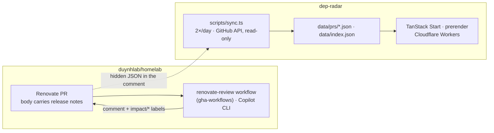

# dep-radar

Inbox for the Renovate pull requests of [duynhlab/homelab](https://github.com/duynhlab/homelab):
every open PR grouped by what it needs from the owner, with the AI-read release
notes, the files it touches in the homelab, and the checks to run before merging.

Key property, inherited from [release-radar](https://github.com/duynhlab/release-radar):
**no database, no runtime API calls, no client-side tokens**. The site is a
pure function of the committed JSON. The review itself lives on the pull
request, where the merge decision is made; this site is a view of it.

## What a row means

Every open PR lands in exactly one bucket, decided at sync time:

| # | Bucket | Condition | What to do |
|---|---|---|---|
| 0 | Held by owner | `hold` label | Nothing; the decision is on the audit issue |
| 1 | Breaking, needs a decision | review `impact: breaking` | Read the detail, plan the migration or hold |
| 2 | Safe, verify before merge | review `verdict: hold` or `impact: minor` | Run the checklist, then merge |
| 3 | Ready to merge | `impact: none`, CI green, no conflicts | Merge |
| 4 | Blocked | CI failing or conflicts | Rebase or fix CI |
| 5 | Waiting for a review | no review, or the PR moved since | Wait for the workflow, or dispatch a backfill |

Merged and closed PRs stay for 30 days as history, then drop out.

## Commands

| Command | Purpose |
|---|---|
| `pnpm sync` | Snapshot the PRs (needs `GITHUB_TOKEN`; read-only) |
| `pnpm dev:fixture` | Overlay the review fixtures onto `data/` for a local preview; `pnpm sync` restores |
| `pnpm gen` | Validate `data/index.json`, emit the typed module, copy PR assets |
| `pnpm dev` | Vite dev server |
| `pnpm test` | Vitest: unit + dom + worker projects |
| `pnpm lint` / `pnpm typecheck` | ESLint / tsc |
| `pnpm build` | Production build + prerender (inbox + one page per PR) |
| `pnpm check:bundle` | Prove release notes stay out of the worker |
| `pnpm preview` | Build + serve on workerd locally |

## Code map

| Path | What it is |
|---|---|
| `config/source.yaml` | Source repository, bot login, branch prefix, retention |
| `src/domain/types.ts` | Zod schemas. `ReviewSchema` mirrors the homelab review contract key for key |
| `src/domain/buckets.ts` | The inbox rule: one bucket per PR |
| `src/domain/areas.ts` | File path → homelab area (`area/*` labels) |
| `src/domain/renovate-body.ts` | Renovate PR body parser: update table, release notes, truncation |
| `src/domain/snapshot.ts` | Review-comment parser, index projection, deterministic serialization |
| `scripts/sync.ts` | Octokit sync; writes `data/` only when content changed |
| `src/data/` | Isomorphic accessors: bundled index, asset-fetched PR records |
| `src/features/inbox/` | Filters, URL search params, the inbox view |
| `src/components/review/` | Detail-page sections: verdict, breaking, affected files, checklist, provenance |
| `src/components/app/` | Application wrappers over the shadcn primitives: status badges, status icons, detail header and field grid, chips |
| `src/components/ui/` | shadcn `base-nova` primitives (Base UI), kept pristine |
| `.claude/skills/product-design/` | The design contract the UI follows (vendored from admin-service) |
| `data/` | **Generated.** Never edit by hand; the sync overwrites it |
| `.github/workflows/sync.yaml` | Twice-daily sync, `contents: write`, commits only if `data/` changed |

## The review contract

The homelab side (reusable workflow `renovate-review` in
[gha-workflows](https://github.com/duynhlab/gha-workflows)) posts one comment
per PR, replaced on every push. Its first line is
`<!-- dep-radar:v1 {json} -->`; the JSON matches `schema.json` there and
`ReviewSchema` here. A comment that fails to parse is surfaced on the detail
page as a schema disagreement rather than hidden.

## Deployment

Cloudflare Workers, connected through Workers Builds (Git integration):

- **Build command**: `pnpm build`
- **Deploy command**: `pnpm exec wrangler deploy`
- Data commits trigger a rebuild; `ci.yaml` ignores them.
